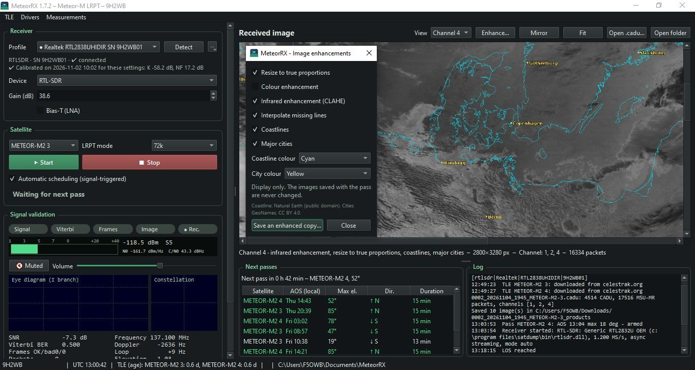

# MeteorRX — User Guide

**Version 2.0.0 · November 2026**
**Stephan 9H2WB / F5OWB · Malta Amateur Radio League (MARL)**

> MeteorRX was written for the members of the **Malta Amateur Radio League** who want weather pictures from the
> Russian **Meteor-M** satellites without having to learn a general-purpose satellite suite first. It does one
> job: receive Meteor-M LRPT, show you whether the signal is good, and save the pictures.

---

## 1. What you need

| Item | Recommendation |
|---|---|
| **Antenna** | Any right-hand circular or omni 137 MHz antenna: V-dipole (simplest), turnstile or QFH (best). Outdoors, clear horizon. |
| **Preamplifier + filter** | Strongly recommended: a 137 MHz LNA (NF ≤ 1 dB, ~20 dB gain) with a band-pass filter, at the antenna, powered by Bias-T. It cures most "no image" cases. |
| **Receiver** | One of the receivers below. |
| **PC** | Windows 10 or 11, 64-bit, any recent laptop. Internet only for the orbit data (TLE). |

| Receiver | Status | Extra software |
|---|---|---|
| RTL-SDR (Blog V3/V4, generic R820T) | Tested on the bench (MARL LRPT test pattern) | none (driver bundled; Zadig offered if Windows bound the wrong USB driver) |
| SDRplay RSP1A | Tested on the bench | *SDRplay API 3.x* from sdrplay.com |
| SDRplay RSP1, RSP1B, RSP2, RSPduo, RSPdx, RSPdx-R2 | Supported (per-model settings) | *SDRplay API 3.x* |
| LimeSDR Mini 2.0 (and 1.x) | Tested on the bench | SatDump 1.2 installed (MeteorRX uses its `LimeSuite.dll`) + FTDI D3XX driver **1.3.0.10 x64 (WDF)** |
| HackRF One | Control and stream tested | SatDump or SDR++ installed (MeteorRX uses its `hackrf.dll`) + WinUSB driver (Zadig) |
| Airspy R2 / Mini | **Experimental — in test, no warranty** | SatDump or SDR++ installed (MeteorRX uses its `airspy.dll`) + WinUSB driver (Zadig). Set `device = airspy`. |
| Airspy HF+ Discovery / Dual Port | **Experimental — in test, no warranty** | SatDump or SDR++ installed (MeteorRX uses its `airspyhf.dll`). Set `device = airspyhf`. The HF+ covers 137 MHz in its VHF band. |
| PlutoSDR (ADALM-Pluto) | Supported | none (MeteorRX talks to the Pluto over its network interface) |

## 2. Installation

1. Download `MeteorRX-x.y.z-win64.zip` from the **Releases** page.
2. Unzip it anywhere (Desktop, `C:\MeteorRX`, a USB stick). Nothing is installed in Windows.
3. Double-click **`MeteorRX.exe`**. It opens in a second or two — the signal-processing engine is
   compiled into the program, so there is no first-run preparation wait.
4. If Windows SmartScreen says *"Windows protected your PC"*: *More info › Run anyway* (the program is not
   signed with a paid certificate).

**Updating:** unzip the new version over the old one. Your settings (`meteorrx.ini`) and receiver profiles and
calibrations (`data\`) are kept. Your pictures are in `Documents\MeteorRX` and are never touched.

## 3. First set-up (5 minutes)

1. **Your station.** Open `meteorrx.ini` (next to the exe) with Notepad and set, in `[station]`:
   `latitude`, `longitude` (decimal degrees, east and north positive), `altitude_m` and `callsign`.
   The default position is Malta. Save, restart MeteorRX.
2. **Language.** `[gui] language = en`, `fr`, `it`, `es` or `de` (English, French, Italian, Spanish, German).
3. **Receiver.** Plug it in, click **Detect** in the *Receiver* panel, pick the device type and check the
   gains (recommended starting values below). A profile is created automatically for each receiver
   (by serial number): its settings and calibrations follow it.
4. **Orbit data** is downloaded automatically (CelesTrak, then SatNOGS) and refreshed every 12 hours.
   The *Next passes* list under the picture fills in.

| Receiver | Starting gain | Notes |
|---|---|---|
| RTL-SDR | 38.6 dB | Lower it if strong FM / pager signals are near |
| SDRplay | gain reduction 40 dB, LNA state 3 | FM notch on |
| HackRF One | LNA 24, VGA 30, amp off | Amp on only without an external preamp |
| LimeSDR Mini | 40 dB | RX input *auto* (LNAW) |
| PlutoSDR | 50 dB | address `ip:192.168.2.1` (Pluto on USB) |

Bias-T: tick it only if your preamplifier is powered through the coax.

## 4. The window

**Left — controls and signal check**

* **Receiver**: profile (● connected, ○ not connected), device, gains, Bias-T, *preamp in service*.
* **Satellite** and LRPT **mode** (*auto* is fine), **Start / Stop**, automatic scheduling.
* **LEDs**: *Signal · Viterbi · Frames · Image · Rec*.
* **S-meter**: level in dBm and S-units once the receiver is calibrated (section 7), otherwise in dBFS.
* **Audio monitor**: *Listen* lets you hear the satellite (a steady rushing tone) on the PC speakers. It starts
  muted and has no effect on decoding.
* **Eye diagram** and **constellation**: the best indicators of signal quality.
* Measurements: SNR, Viterbi BER, frames, packets, frequency, Doppler, elevation, recording time,
  *SDR stream* (must stay near 100 %).
* **Spectrum** 137 MHz with the two Meteor frequencies marked.

**Right — result**: the picture as it is received (zoom with the mouse wheel, drag to pan), then the
**next passes** and the **log**.

F11 = full screen, Esc = back.

### What a good signal looks like

| Indicator | Good | Problem |
|---|---|---|
| Eye diagram | Open eye, two clear levels in the middle | Closed, noisy band |
| Constellation | Four tight dots | A ring or a cloud |
| Viterbi BER | below 0.06 | 0.10 and above |
| LEDs | *Frames* and *Image* green | *Signal* only |
| SDR stream | 98–100 % | below 95 % (PC too busy, USB problem) |

## 5. Receiving a pass

**Automatic (default).** Leave MeteorRX running. About a minute before each pass higher than
`min_elevation` (15° by default) the receiver is armed. Recording starts by itself when the satellite is
heard and stops at loss of signal. The pictures are saved and MeteorRX waits for the next pass.

**Manual.** Choose the satellite, press **Start**, press **Stop** at the end.

A pass lasts 10–15 minutes. Best pictures come from passes above 40° elevation. Meteor-M N2-3 and N2-4
transmit on 137.900 or 137.100 MHz; MeteorRX listens to both frequencies at once and follows the Doppler shift.

## 6. Your pictures

Each reception gets its own numbered folder in **`Documents\MeteorRX`**, for example
`0007_20261027_0912_METEOR-M2-4\`:

| File | Content |
|---|---|
| `…_rgb221.png` | Natural-colour composite (daytime) |
| `…_rgb124.png` | MSU-MR false colour, the same combination SatDump produces under that name: sea dark, vegetation green, cloud tops yellow to white |
| `…_rgb123.png` | Alternative composite, daytime only (needs channel 3) |
| `…_ch1.png … _ch6.png` | Individual channels (visible and infrared) |
| `…_ch4_inv.png` | Infrared, inverted (clouds white) |
| `…_info.json` | Pass information (satellite, session number, times, orbital elements) |
| `….tle` | The orbital elements this pass was received against, as a plain three-line TLE. Keep it with the `.cadu`: replaying the pass in a year still places the coastlines where they really were. Any tracking program reads this file |
| `….cadu` | Raw frames, can be re-processed by MeteorRX or SatDump |

Nothing is ever overwritten: a new reception always gets the next number. The *Open folder* button goes
straight there.

Which composites are written is set by `composites` in `meteorrx.ini`; the default is `221, 124, 123`.
Remove one from that line if you do not want the file.

## 6b. Improving a picture, and putting the map on it

The toolbar above the picture is display-only: nothing there changes a file that has already been saved.
*Enhance…* opens a small panel you can leave open while you try combinations.

| Control | What it does |
|---|---|
| *Resize to true proportions* | Undoes the foreshortening at the edge of the swath (1568 → 2800 px wide) |
| *Colour enhancement* | Lifts the haze cast off a composite without changing the hue |
| *Infrared enhancement* | Brings out cloud-top structure on an infrared channel |
| *Interpolate missing lines* | Fills short gaps left by lost frames (on by default) |
| *Coastlines* / *Major cities* | Draws the map on the picture, in a colour you choose |

**Save** at the bottom of the panel writes the picture **exactly as it appears on screen** into the pass
folder, as `<pass prefix>_enhanced.png`, then `..._enhanced_2.png` and so on. The decoded images and the
`.cadu` are never touched.

If the caption under the picture says **"overlays not placed (no TLE)"**, the pass could not be located on
the Earth, so no coastline or city can be drawn — neither on screen nor in the saved copy. This is not a
fault in the save. It happens when MeteorRX had no orbital elements for the pass. From 1.7.3 a recording you
started by hand works this out for itself, so you should only see it if no satellite was above the horizon
at the time, or if no TLE has been downloaded yet.

## 7. Calibration and preamplifier check (optional)

With a signal generator (for example a Viavi 3920) you can calibrate the receiver so that the S-meter reads
real dBm, measure the receiver noise figure, and measure the real gain and noise figure of your
preamplifier. Menu **Measurements › Receiver calibration / preamplifier qualification**:

1. Generator at 137.900 MHz, cable loss entered, three levels (−70, −90, −110 dBm): *Measure* at each.
2. Generator RF off (still connected): *Noise*. *Compute and save*.
3. Insert the preamplifier (powered), −110 dBm: *Measure*, then *Noise* → real gain and noise figure.
   MeteorRX then offers to put the preamp *in service*: the S-meter then reads the level at the antenna.

A calibration is valid for the gain settings it was made with; each receiver keeps its own.

## 8. Troubleshooting

| Symptom | What to do |
|---|---|
| Receiver not found (RTL-SDR) | Accept the Zadig offer: select the dongle, *WinUSB*, *Replace Driver*. Once per USB port. |
| Receiver not found (SDRplay) | Install SDRplay API 3.x; close any other SDR program. |
| LimeSDR not found | Install FTDI D3XX driver **1.3.0.10 x64 (WDF)** — not the 1.4.x WinUSB one; SatDump 1.2 must be installed. |
| HackRF not found | WinUSB driver with Zadig; SatDump or SDR++ installed. |
| *Signal* LED but no frames | Check the eye and the BER: usually too weak (add or check the preamp, antenna outdoors), or too strong / overloaded (lower the gain). |
| Picture with gaps | Low elevation, obstacles, or interference. Watch *SDR stream*: below 95 % the PC is losing samples. |
| No passes listed | No orbit data: check Internet, or *TLE › Import TLE file…* |
| You want fewer downloads | MeteorRX fetches only what it needs, but if you leave it running for days or only work the odd pass, set `[tle] refresh_days` in `meteorrx.ini` to 2, 3 or 7. *TLE › Update now* always downloads |
| Windows Defender removes the exe | False positive of unsigned programs: restore it and report it to Microsoft, or build it yourself (`build_exe.bat` in the sources). |

**Quick receiver test** (console, in the MeteorRX folder):

    MeteorRX-cli --selftest
    MeteorRX-cli --live 30 --device rtlsdr

`--live` prints every second the stream rate, SNR, carrier offset, Viterbi BER and frames. With a test signal
or a satellite overhead you should see frames counting up and BER 0.000. Devices: `rtlsdr`, `sdrplay`,
`hackrf`, `lime`, `pluto`.

## 9. Command-line summary

| Command | Purpose |
|---|---|
| `MeteorRX-cli --selftest` | Check the installation |
| `MeteorRX-cli --drivers` | RTL-SDR driver diagnostics |
| `MeteorRX-cli --live 30 [--device D] [--record f.cs16]` | Live receiver test, optional IQ recording |
| `MeteorRX-cli recording.wav [--rate R] [--center MHz]` | Decode an IQ recording |
| `MeteorRX-cli pass.cadu` | Re-make pictures from saved frames |
| `MeteorRX-cli --measure 137.9 [seconds]` | Level / noise measurement |

## 10. Support, licence, credits

* Questions and bug reports: the **Issues** page of the GitHub repository. Please attach the output of
  `MeteorRX-cli --live 30` and `data\meteorrx.log`.
* **Help improve the coastline / city overlays.** The map is placed by real geolocation from the pass's
  orbital elements, and it is already accurate. To let us check and fine-tune it across more orbits and
  receivers, share a reception **folder** as a set of three files: the `*.cadu` recording, the `*.tle`
  file MeteorRX saved **beside it** (it holds the exact two orbital-element lines the pass used), and
  `data\meteorrx.log`. A `.cadu` on its own cannot be re-placed — the two TLE lines are what the overlay
  needs.
* MeteorRX is **free-to-use amateur-radio software** under the **MeteorRX License 2.0** (see `LICENSE`):
  use and test it freely; please do not redistribute it — point others to the official download page instead.
  Bundled under their own licences: RTL-SDR Blog driver (GPL-2.0+) and Zadig (GPL-3.0); see `THIRD_PARTY_NOTICES.md`.
* Written by **Stephan, 9H2WB / F5OWB**, for the **Malta Amateur Radio League (MARL)**, at the request of
  **Joe 9H1VW**. Long hours of testing by **Anthony "Tony" Musumeci IK1HGI**. Thanks also to all the OMs who
  have been running after our successive versions — your logs found most of what has been fixed.
* Coastlines: Natural Earth (public domain). City names: GeoNames, CC BY 4.0.

---

## Résumé en français

**MeteorRX** reçoit les images des satellites météo **Meteor-M** (LRPT 137 MHz) avec un RTL-SDR, un SDRplay, un
LimeSDR Mini, un HackRF One, un Airspy (R2/Mini/HF+, en test) ou un PlutoSDR, et les enregistre dans `Documents\MeteorRX`.

1. **Installer** : dézipper `MeteorRX-x.y.z-win64.zip`, lancer `MeteorRX.exe` (démarrage immédiat).
2. **Régler** : dans `meteorrx.ini`, section `[station]`, latitude, longitude, altitude, indicatif ;
   `[gui] language = fr` (aussi en, it, es, de).
3. **Récepteur** : *Détecter*, choisir le type, gains conseillés au §3 ; Bias-T seulement si le préampli est
   alimenté par le coax.
4. **Recevoir** : laisser tourner — chaque passage au-dessus de 15° est enregistré automatiquement.
   Un bon signal : œil ouvert, 4 points nets, BER Viterbi < 0,06, voyants *Trames* et *Image* verts.
5. **Améliorer** : *Enhance…* au-dessus de l'image — proportions réelles, rehaussement couleur ou infrarouge,
   traits de côte et noms de villes (couleur au choix). **Save** écrit l'image **exactement telle qu'affichée**
   dans le dossier du passage, en `…_enhanced.png`. Si la légende indique *calque non placé (pas de TLE)*,
   le passage n'a pas pu être localisé : aucun tracé n'est possible, ni à l'écran ni dans le fichier.
6. **Dépannage** : tableau du §8 ; test rapide `MeteorRX-cli --live 30 --device rtlsdr`.

*Stephan 9H2WB / F5OWB — Malta Amateur Radio League (MARL)*
